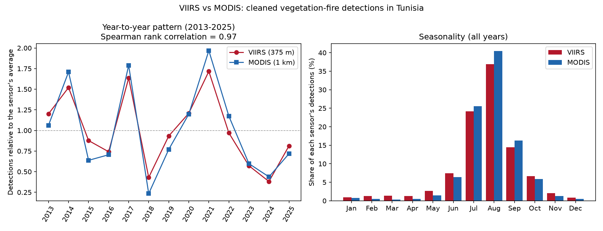
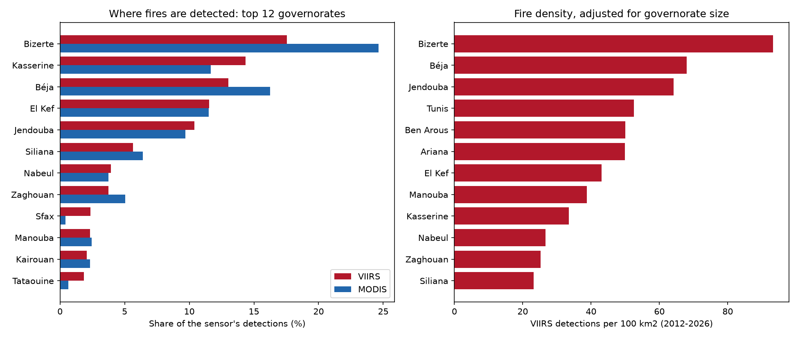

# Deep Learning for Wildfire Risk and Burned-Area Mapping in Tunisia

An independent research project analyzing NASA Earth observation data to characterize wildfire patterns in Tunisia, model fire risk, and automatically map burned areas with deep learning.

**Status:** In progress. The live fire map and the historical VIIRS and MODIS analysis are done; weather drivers and modeling come next. 🚧

## Goals

1. Characterize wildfire patterns in Tunisia over two decades (NASA FIRMS: VIIRS from 2012, MODIS from 2001)
2. Identify the climatic and vegetation drivers of fire risk (MERRA-2, NDVI)
3. Build a Random Forest baseline for fire risk
4. Train a PyTorch U-Net for burned-area segmentation, using MODIS MCD64A1 as reference labels, and compare it to the baseline (target Dice > 0.80)
5. Produce burned-area maps and a technical report

Focus area: the Kroumirie-Mogods region in the northwest, a historically fire-affected zone.

## Why

Tunisia has little public research on wildfire patterns, while NASA provides free, open data going back more than 20 years.

## Results so far (preliminary)

Active-fire detections for Tunisia from two NASA sensors: VIIRS S-NPP (375 m, January 2012 to November 2026) and MODIS Terra and Aqua (1 km, 2001 to 2026). After cleaning, 19,753 VIIRS and 6,437 MODIS vegetation-fire detections remain.



- **The two sensors agree closely.** Over the 13 full years covered by both (2013 to 2025), yearly detection counts have a rank correlation of 0.97, despite the different resolutions. Both rank 2021, 2017 and 2014 as the three most active years and 2018, 2024 and 2023 as the three quietest. With 13 years this is an indication, not proof.
- **Fires are strongly seasonal.** June to September holds 83% of cleaned VIIRS detections and 89% of MODIS detections, with the peak in August.
- **Almost half of the raw VIIRS archive is not wildfire.** 46% of archive detections are flagged as static land sources (gas flares, industrial heat), against 8% for MODIS, so cleaning was essential.
- **The northwest is the fire hot spot.** Jendouba, Béja and Bizerte, the governorates that contain the Kroumirie-Mogods region, cover roughly 7% of Tunisia's area but hold 41% of cleaned VIIRS detections and 51% of MODIS detections. They rank first to third in fire density (VIIRS detections per 100 km²: Bizerte 93, Béja 68, Jendouba 64). Kasserine and El Kef have more detections than Jendouba in absolute terms, but they are larger and less dense.
- **Caveat for the south and east.** VIIRS records 8 to 19 times more detections than MODIS in Sfax, Gabès, Tataouine, Kébili and Gafsa, against 2 to 4 times in the north, so VIIRS counts there probably still include industrial or very small sources. A few small governorates around Tunis also show high density and need checking for non-wildfire burning. The northern results hold in both sensors.
- Download `outputs/tunisia_fire_density.html` and open it in a browser for the interactive VIIRS heatmap. Its brightest clusters, in the west near the Algerian border, are still to be investigated.



Per-sensor charts: [VIIRS per year](outputs/fires_per_year.png), [VIIRS seasonality](outputs/fires_per_month.png), [MODIS per year](outputs/modis_fires_per_year.png), [MODIS seasonality](outputs/modis_fires_per_month.png).


## Data cleaning

Applied in `src/analyze_fires.py` (VIIRS) and `src/analyze_modis.py` (MODIS):

1. Keep only archive detections classified as presumed vegetation fires (type 0).
2. Recent near-real-time detections have no type, so those that fall within one grid cell of a known static source are removed.
3. Drop low-confidence detections (VIIRS: letter `l`; MODIS: confidence below 30).
4. Remove persistent fixed sources the type flag missed: any grid cell active in 6 or more different calendar months, or with too many detections (VIIRS: 40 per ~500 m cell; MODIS: 20 per ~1 km cell), plus its neighbouring cells. Removed detections are saved for inspection.

Sanity check on step 4: the removed detections are mostly night-time and spread across the year (VIIRS: 91% night; MODIS: 97% night), while the kept detections are mostly daytime and concentrated in summer (June to September: VIIRS 83%, MODIS 89%), as expected for wildfires.

Result: VIIRS 57,879 raw detections reduced to 19,753; MODIS 7,488 reduced to 6,437. The thresholds in step 4 are heuristics, chosen after inspecting the most-repeated cells (`src/check_hotspots.py`), and will be revisited. MODIS counts for 2001 and 2002 are lower partly because Aqua only launched in mid-2002.

## Data sources

| Source | Used for |
|---|---|
| [NASA FIRMS](https://firms.modaps.eosdis.nasa.gov/) (VIIRS 2012+, MODIS 2001+) | Active fire detections |
| MODIS MCD64A1 | Monthly burned-area product, used as segmentation labels |
| MERRA-2 | Meteorological reanalysis (temperature, humidity, wind, rainfall) |
| [Copernicus Data Space](https://dataspace.copernicus.eu/) (Sentinel-2) | NDVI and before/after imagery |
| [geoBoundaries](https://www.geoboundaries.org/) | Tunisia governorate boundaries |

## Roadmap

**Phase 1: Live detection**
- [x] Project setup and Python environment
- [x] Near-real-time VIIRS fire data from the FIRMS API
- [x] Interactive map with governorate boundaries (`outputs/tunisia_fires_live.html`)
- [x] Single fetch-and-plot pipeline (`src/live_map.py`)

**Phase 2: Historical data and exploration**
- [x] Download historical VIIRS (2012 to 2026) and MODIS (2001 to 2026) archives
- [x] Clean both datasets and remove fixed industrial sources
- [x] Seasonality, yearly trends and density map
- [x] Cross-check VIIRS against MODIS
- [x] Per-governorate statistics
- [ ] Spatial clustering of persistent hotspots (DBSCAN/HDBSCAN)

**Phase 3: Drivers and baseline model**
- [ ] Download MERRA-2 weather variables and compute NDVI
- [ ] Add terrain and distance-to-road/settlement features
- [ ] Random Forest fire-risk baseline with time-aware and spatial validation

**Phase 4: Burned-area segmentation**
- [ ] Prepare MCD64A1 burned-area labels
- [ ] PyTorch U-Net for burned-area segmentation
- [ ] Compare against the Random Forest baseline (Dice)
- [ ] Burn severity (NBR) case study on one recent fire

**Phase 5: Write-up**
- [ ] Burned-area maps, technical report, demo

## Project structure

```
.
├── src/
│   ├── live_map.py          # Fetches recent VIIRS detections and builds the live map
│   ├── boundaries.py        # Downloads Tunisia governorate boundaries
│   ├── explore_history.py   # Merges the downloaded VIIRS CSVs and prints summary statistics
│   ├── analyze_fires.py     # Cleans the VIIRS data, makes charts and the density map
│   ├── explore_modis.py     # Merges the downloaded MODIS CSVs and prints summary statistics
│   ├── analyze_modis.py     # Cleans the MODIS data and makes charts
│   ├── compare_sensors.py   # Compares VIIRS and MODIS year by year and by season
│   ├── governorate_stats.py # Counts detections per governorate and fire density
│   └── check_hotspots.py    # Lists the most-repeated detection cells (fixed-source check)
├── data/                    # Downloaded data (not tracked by git)
├── outputs/                 # Generated charts and maps
├── notebooks/               # Exploration notebooks
├── requirements.txt
└── README.md
```

## Getting started

Requires Python 3 and a free [NASA FIRMS MAP_KEY](https://firms.modaps.eosdis.nasa.gov/api/).

```powershell
git clone https://github.com/oumaimaDh/Deep-Learning-for-Wildfire-Risk-and-Burned-Area-Mapping-in-Tunisia.git
cd Deep-Learning-for-Wildfire-Risk-and-Burned-Area-Mapping-in-Tunisia

python -m venv venv
venv\Scripts\Activate
pip install -r requirements.txt
```

Create a `.env` file in the project root (it is gitignored):

```
FIRMS_MAP_KEY=your_key_here
```

Live map:

```powershell
python src/boundaries.py    # one-time: downloads governorate boundaries
python src/live_map.py      # saves outputs/tunisia_fires_live.html
```

Historical analysis: request Tunisia's VIIRS S-NPP and MODIS archives (CSV) from the [FIRMS download page](https://firms.modaps.eosdis.nasa.gov/download/). Unzip the VIIRS files into `data/viirs_raw/` and the MODIS files into `data/modis_raw/`, then run:

```powershell
python src/explore_history.py    # merge the VIIRS CSVs, print summary statistics
python src/analyze_fires.py      # clean VIIRS, save charts and the density map to outputs/
python src/explore_modis.py      # merge the MODIS CSVs, print summary statistics
python src/analyze_modis.py      # clean MODIS, save charts to outputs/
python src/compare_sensors.py    # compare the two sensors
python src/governorate_stats.py  # detections and fire density per governorate
```

Notes:
- The near-real-time endpoint only returns the last 1 to 5 days, and the live map can be empty outside the summer fire season.
- Data files are gitignored, so each user downloads their own copy.

## Author

Oumaima Dhaouadi, 3rd year Computer Science Engineering student at ESPRIT (AI specialization). [GitHub](https://github.com/oumaimaDh)