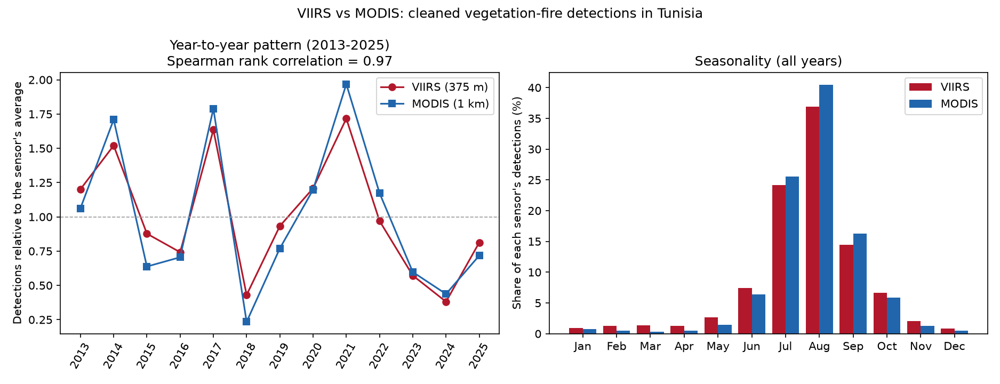
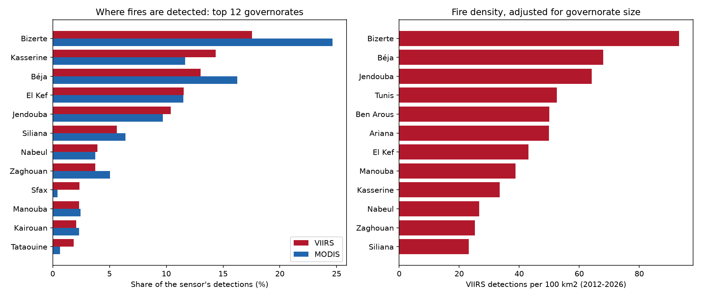
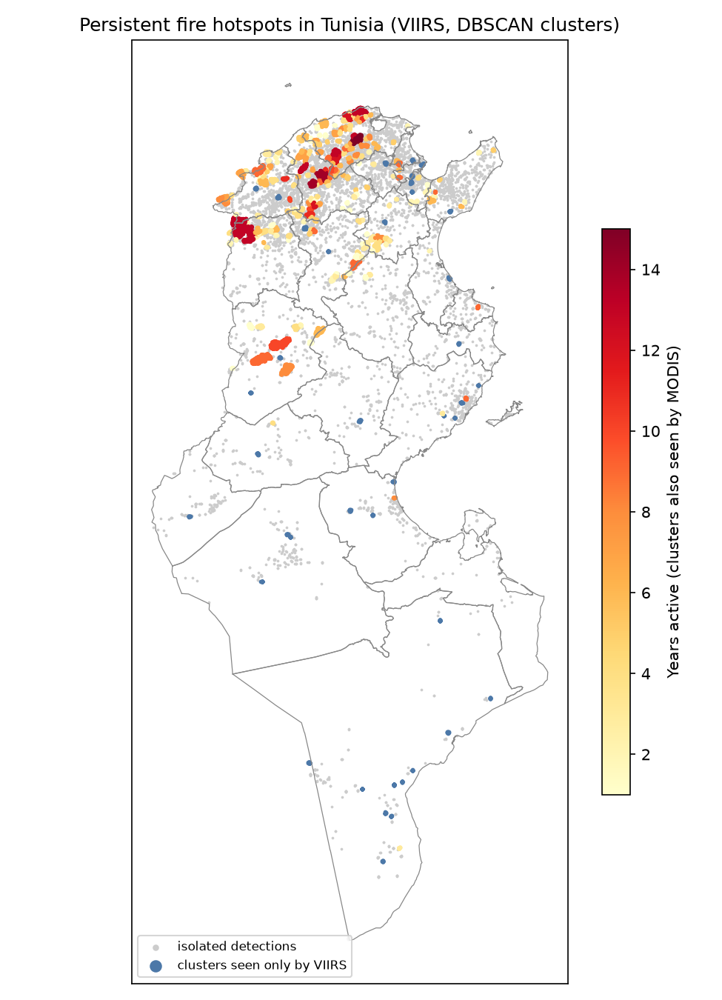
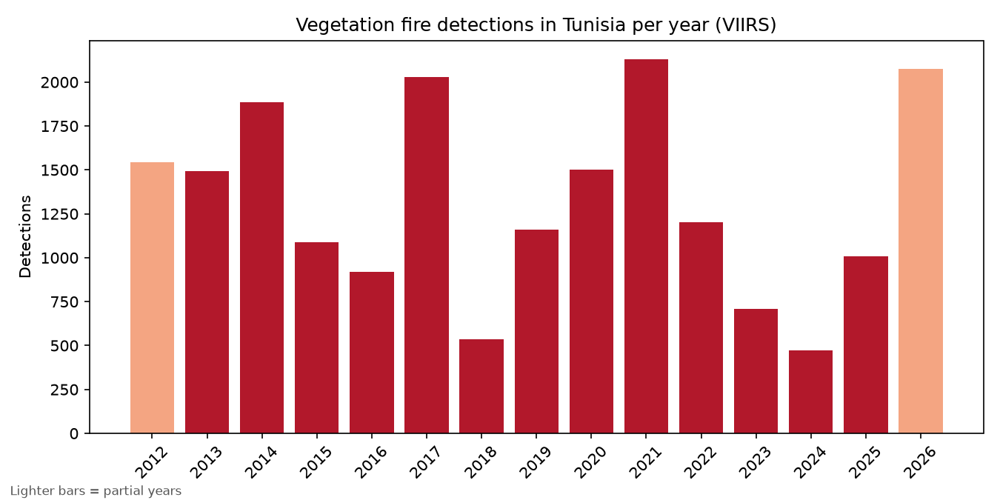
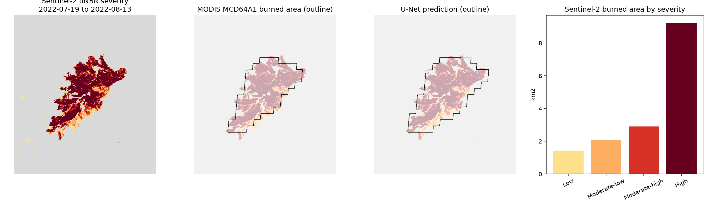

# Deep Learning for Wildfire Risk and Burned-Area Mapping in Tunisia

An independent research project analyzing NASA Earth observation data to characterize wildfire patterns in Tunisia, model fire risk, and automatically map burned areas with deep learning.

**Status:** In progress. The live fire map, the historical VIIRS and MODIS analysis, the fire-risk models (weather, vegetation, spatial validation) and a first U-Net for burned-area mapping are done. A Sentinel-2 burn-severity case study and a technical report ([REPORT.md](REPORT.md)) are done. Results are preliminary: the burned-area model is far below its target accuracy and small fires remain the main open problem. 🚧

## Headline results

| What | Result |
|---|---|
| Raw VIIRS detections removed as likely non-wildfire (gas flares, industry, low confidence) | 66% (57,879 reduced to 19,753) |
| Agreement between VIIRS and MODIS on yearly fire counts | 0.97 rank correlation over 13 years (0.96 against MODIS burned area) |
| Persistent, MODIS-confirmed fire hotspots | 102, of which 73% are in Bizerte, Béja and Jendouba |
| Fire-risk model on unseen years (PR-AUC) | 0.13, against 0.04 for a seasonal average |
| U-Net burned-area map on unseen years, Tunisia only (Dice) | 0.15, against 0.05 for a Random Forest and 0.03 for a dNBR threshold; small Tunisian fires are hard at 500 m (target 0.80 not reached) |

Details, caveats and charts are below.

## Goals

1. Characterize wildfire patterns in Tunisia over two decades (NASA FIRMS: VIIRS from 2012, MODIS from 2001)
2. Identify the climatic and vegetation drivers of fire risk (MERRA-2, NDVI)
3. Build a Random Forest baseline for fire risk
4. Train a PyTorch U-Net for burned-area segmentation, using MODIS MCD64A1 as reference labels, and compare it to the baseline (target Dice > 0.80)
5. Produce burned-area maps and a technical report

Focus area: the Kroumirie-Mogods region in the northwest, a historically fire-affected zone.

## Why

Tunisia has little public research on wildfire patterns, while NASA provides free, open data going back more than 20 years.

## Results so far (preliminary)

Active-fire detections for Tunisia from two NASA sensors: VIIRS S-NPP (375 m, January 2012 to November 2026) and MODIS Terra and Aqua (1 km, 2001 to 2026). After cleaning, 19,753 VIIRS and 6,437 MODIS vegetation-fire detections remain.



- **The two sensors agree closely.** Over the 13 full years covered by both (2013 to 2025), yearly detection counts have a rank correlation of 0.97, despite the different resolutions. Both rank 2021, 2017 and 2014 as the three most active years and 2018, 2024 and 2023 as the three quietest. With 13 years this is an indication, not proof.
- **Fires are strongly seasonal.** June to September holds 83% of cleaned VIIRS detections and 89% of MODIS detections, with the peak in August.
- **Almost half of the raw VIIRS archive is not wildfire.** 46% of archive detections are flagged as static land sources (gas flares, industrial heat), against 8% for MODIS, so cleaning was essential.
- **The northwest is the fire hot spot.** Jendouba, Béja and Bizerte, the governorates that contain the Kroumirie-Mogods region, cover roughly 7% of Tunisia's area but hold 41% of cleaned VIIRS detections and 51% of MODIS detections. They rank first to third in fire density (VIIRS detections per 100 km²: Bizerte 93, Béja 68, Jendouba 64). Kasserine and El Kef have more detections than Jendouba in absolute terms, but they are larger and less dense.
- **Caveat for the south and east.** VIIRS records 8 to 19 times more detections than MODIS in Sfax, Gabès, Tataouine, Kébili and Gafsa, against 2 to 4 times in the north, so VIIRS counts there probably still include industrial or very small sources. A few small governorates around Tunis also show high density and need checking for non-wildfire burning. The northern results hold in both sensors.
- **Fires keep returning to the same places.** DBSCAN clustering of the cleaned VIIRS detections (1 km distance, at least 10 detections) finds 255 clusters. 128 are persistent, meaning active in 5 or more different years. 102 of those are also seen by MODIS (3 or more MODIS detections nearby) and hold 73% of all clustered detections. Bizerte (41 clusters), Béja (25) and Jendouba (8) host 74 of these 102 (73%). The most persistent clusters in Bizerte and Béja were active in 14 to 15 of the 15 years from 2012 to 2026.
- **Caveats on the clusters.** Persistence cannot tell forest fires from agricultural burning of the same fields, so land-cover data is needed to separate them. 26 persistent clusters (412 detections) are seen by VIIRS only and are set aside: they are small and lie mostly around Greater Tunis, the east coast and the south, so they are probably not forest fires. The settings were chosen by hand, and the largest cluster (El Kef, 31 km across) probably merges several fire areas, so it will be refined (smaller distance or HDBSCAN).
- **A simple Random Forest already predicts fire risk well.** For each 5 km cell and month in the 12 northern governorates (2012 to 2025), the model predicts whether VIIRS detects a fire, using season, location and fire history from earlier years only. Trained on 2012 to 2021 and tested on 2022 to 2025, it reaches ROC-AUC 0.83 and PR-AUC 0.13, against 0.75 / 0.04 for a seasonal average and 0.76 / 0.05 for cell history alone (random guessing: PR-AUC 0.017).
- **Weather adds little on top of fire history.** Adding MERRA-2 temperature, humidity, wind, rain, soil wetness and vegetation (LAI) raises ROC-AUC from 0.829 to 0.848 but leaves PR-AUC unchanged (0.126 vs 0.124, mean of 3 seeds). Weather alone is informative (PR-AUC 0.067, better than the seasonal average) but largely overlaps with what location and history already capture. MERRA-2 cells are about 50 km wide, so they cannot describe local conditions; finer data (NDVI, terrain) is next.
- **An independent check on the cleaning.** MODIS burned area (MCD64A1, June to October, inside Tunisia only) and the cleaned VIIRS detections inside Tunisia rank the years almost identically: Spearman correlation 0.96 over 2013 to 2025 (p < 0.001, 13 years). Both put 2021 and 2014 among the top three and 2024, 2018 and 2023 as the three quietest (burned area in 2024: 8 km², 2018: 11 km², 2021: 256 km²). Two different NASA products agreeing suggests the cleaned VIIRS counts track real wildfire activity.
- **Vegetation helps most at places the model has never seen.** Adding MODIS vegetation features (NDVI and shortwave infrared from the composite that ended before each month) to the risk model changes little where fire history is known (PR-AUC 0.138 to 0.150 on 2022 to 2025, a small gain on only four test years). The clearer effect is in spatial cross-validation, where whole MERRA-2 cells are held out and the model gets no coordinates or fire history: PR-AUC is 0.059 for season only, 0.073 with weather, 0.096 with vegetation and 0.103 with both (random guessing: 0.037), with a spread of 0.03 to 0.04 across folds. Adding terrain (SRTM elevation, slope, south-facing ground) gives 0.105 with vegetation and 0.106 with everything, a gain well within that spread. An earlier test with smaller blocks showed a larger weather gain (0.122), which shrank once no weather cell was shared between training and test, so weather partly acted as a location code there. Months covered: June to November.
- Download `outputs/tunisia_fire_density.html` and open it in a browser for the interactive VIIRS heatmap. Its brightest clusters, in the west near the Algerian border, are still to be investigated.





Per-sensor charts: [VIIRS per year](outputs/fires_per_year.png), [VIIRS seasonality](outputs/fires_per_month.png), [MODIS per year](outputs/modis_fires_per_year.png), [MODIS seasonality](outputs/modis_fires_per_month.png).



## Burned-area segmentation (preliminary)

A small PyTorch U-Net maps burned pixels from two MODIS MOD13A1 composites 32 days apart (red, near-infrared, shortwave infrared, NDVI, and their change), using MCD64A1 burned pixels as reference labels. It is trained on 2012 to 2020 (the crop box also contains a strip of Algeria), thresholds are chosen on 2021, and it is scored on 2022 to 2025 **inside Tunisia only**.

| Model (test 2022 to 2025, Tunisia) | Dice | IoU | Precision | Recall |
|---|---|---|---|---|
| Simple dNBR threshold | 0.03 | 0.01 | 0.02 | 0.09 |
| Random Forest (per pixel) | 0.05 | 0.03 | 0.03 | 0.14 |
| **U-Net** | **0.15** | 0.08 | 0.14 | 0.16 |

- The U-Net beats both baselines in 2022 and 2023, but 0.15 is far below the project's target Dice of 0.80. Dice per test year: 0.24 (2022), 0.08 (2023), 0.02 (2025); 2024 (0.59) rests on only 4 km² of burn and means little.
- Tunisian fires are small: the test years contain only 942 burned 500 m pixels in Tunisia, roughly 200 km² in total, which are a few pixels wide each. The first version of this evaluation also counted Algerian pixels, where fires are larger, and scored Dice 0.48. That number is not a Tunisian result and was removed.
- Limits: very small test set, one training run, and labels (MCD64A1) computed from the same kind of MODIS data as the inputs, so this measures how well the model learns that product rather than providing a fully independent validation. 500 m pixels are too coarse for most Tunisian fires, so finer imagery (Sentinel-2, 20 m) is the natural next step. A Sentinel-2 case study on one fire is described below.

### Sentinel-2 case study (independent check on one fire)

The largest burn cluster inside Tunisia in 2022 (MODIS: 16 km², 24 to 28 July, near 36.02°N, 9.64°E) was re-mapped from Sentinel-2 images at 20 m, using dNBR = NBR before minus NBR after (images of 19 July and 13 August 2022, both with 0% cloud) and the USGS severity classes. Pixels with dNBR of 0.27 or more count as burned.

| Source | Burned area | Dice against Sentinel-2 (at 500 m) |
|---|---|---|
| Sentinel-2 dNBR | 14.2 km² | reference |
| MODIS MCD64A1 | 15.9 km² | 0.94 |
| U-Net | 18.9 km² | 0.88 |

Severity from Sentinel-2: 9.2 km² high, 2.9 km² moderate-high, 2.1 km² moderate-low, 1.4 km² low.



- This is one large, isolated fire that was chosen from the MODIS data, so it shows that the burned extents agree, not what MODIS or the U-Net miss elsewhere. It is the easy case: over all Tunisian test fires the U-Net Dice is only 0.15.
- The U-Net figure combines the predictions of every image pair overlapping the fire dates, and it slightly overestimates the area.

## Data cleaning

Applied in `src/analyze_fires.py` (VIIRS) and `src/analyze_modis.py` (MODIS):

1. Keep only archive detections classified as presumed vegetation fires (type 0).
2. Recent near-real-time detections have no type, so those that fall within one grid cell of a known static source are removed.
3. Drop low-confidence detections (VIIRS: letter `l`; MODIS: confidence below 30).
4. Remove persistent fixed sources the type flag missed: any grid cell active in 6 or more different calendar months, or with too many detections (VIIRS: 40 per ~500 m cell; MODIS: 20 per ~1 km cell), plus its neighbouring cells. Removed detections are saved for inspection.

Sanity check on step 4: the removed detections are mostly night-time and spread across the year (VIIRS: 91% night; MODIS: 97% night), while the kept detections are mostly daytime and concentrated in summer (June to September: VIIRS 83%, MODIS 89%), as expected for wildfires.

Result: VIIRS 57,879 raw detections reduced to 19,753; MODIS 7,488 reduced to 6,437. The thresholds in step 4 are heuristics, chosen after inspecting the most-repeated cells (`src/check_hotspots.py`), and will be revisited. MODIS counts for 2001 and 2002 are lower partly because Aqua only launched in mid-2002.

## Data sources

| Source | Used for |
|---|---|
| [NASA FIRMS](https://firms.modaps.eosdis.nasa.gov/) (VIIRS 2012+, MODIS 2001+) | Active fire detections |
| MODIS MCD64A1 | Monthly burned-area product, used as segmentation labels |
| SRTM (3 arc-second) | Elevation, slope and aspect features |
| MODIS MOD13A1 | 16-day 500 m reflectance and NDVI, used as U-Net input and risk-model vegetation features |
| MERRA-2 | Meteorological reanalysis (temperature, humidity, wind, rainfall) |
| [Copernicus Data Space](https://dataspace.copernicus.eu/) (Sentinel-2) | NDVI and before/after imagery |
| [geoBoundaries](https://www.geoboundaries.org/) | Tunisia governorate boundaries |

## Roadmap

**Phase 1: Live detection**
- [x] Project setup and Python environment
- [x] Near-real-time VIIRS fire data from the FIRMS API
- [x] Interactive map with governorate boundaries (`outputs/tunisia_fires_live.html`)
- [x] Single fetch-and-plot pipeline (`src/live_map.py`)

**Phase 2: Historical data and exploration**
- [x] Download historical VIIRS (2012 to 2026) and MODIS (2001 to 2026) archives
- [x] Clean both datasets and remove fixed industrial sources
- [x] Seasonality, yearly trends and density map
- [x] Cross-check VIIRS against MODIS
- [x] Per-governorate statistics
- [x] Spatial clustering of persistent hotspots (DBSCAN; HDBSCAN refinement possible)

**Phase 3: Drivers and baseline model**
- [x] Download MERRA-2 weather variables (`src/fetch_merra2.py`)
- [x] Random Forest fire-risk baseline with a time-based split (`src/train_baseline.py`)
- [x] Add MERRA-2 weather features and compare (`src/train_weather.py`)
- [x] Vegetation features (MODIS NDVI and shortwave infrared) in the risk model (`src/train_risk_v2.py`)
- [x] Spatial cross-validation on unseen places
- [x] Terrain features from SRTM (`src/fetch_terrain.py`): small gain, within the spread across folds

**Phase 4: Burned-area segmentation**
- [x] Prepare MCD64A1 burned-area labels (`src/fetch_mcd64a1.py`)
- [x] PyTorch U-Net for burned-area segmentation (`src/train_unet.py`)
- [x] Compare against Random Forest and dNBR baselines (Tunisia-only Dice 0.15 vs 0.05 and 0.03; target 0.80 not reached)
- [x] Burn severity (dNBR) case study on one fire with Sentinel-2 (`src/case_study_s2.py`)

**Phase 5: Write-up**
- [x] Burned-area maps, technical report ([REPORT.md](REPORT.md)) and interactive maps

## Project structure

```
.
├── src/
│   ├── live_map.py          # Fetches recent VIIRS detections and builds the live map
│   ├── boundaries.py        # Downloads Tunisia governorate boundaries
│   ├── explore_history.py   # Merges the downloaded VIIRS CSVs and prints summary statistics
│   ├── analyze_fires.py     # Cleans the VIIRS data, makes charts and the density map
│   ├── explore_modis.py     # Merges the downloaded MODIS CSVs and prints summary statistics
│   ├── analyze_modis.py     # Cleans the MODIS data and makes charts
│   ├── compare_sensors.py   # Compares VIIRS and MODIS year by year and by season
│   ├── governorate_stats.py # Counts detections per governorate and fire density
│   ├── find_hotspots.py     # Clusters detections (DBSCAN) to find persistent hotspots
│   ├── fetch_merra2.py      # Downloads monthly MERRA-2 weather for Tunisia (needs an Earthdata login)
│   ├── train_baseline.py    # Random Forest fire-risk baseline (season, place, history)
│   ├── train_weather.py     # Adds MERRA-2 weather features and compares models
│   ├── fetch_mcd64a1.py     # Downloads MODIS burned-area tiles and crops northern Tunisia
│   ├── fetch_mod13a1.py     # Downloads MODIS 16-day reflectance and NDVI composites
│   ├── fetch_terrain.py     # Downloads SRTM elevation and summarises it on a 1 km grid
│   ├── train_risk_v2.py     # Risk model with vegetation features and spatial cross-validation
│   ├── train_unet.py        # U-Net burned-area segmentation vs Random Forest and dNBR
│   ├── burned_area_by_year.py # Burned area per year in Tunisia vs VIIRS counts
│   ├── case_study_s2.py     # Sentinel-2 dNBR case study on one fire
│   └── check_hotspots.py    # Lists the most-repeated detection cells (fixed-source check)
├── data/                    # Downloaded data (not tracked by git)
├── outputs/                 # Generated charts and maps
├── requirements.txt
├── REPORT.md
└── README.md
```

## Getting started

Requires Python 3 and a free [NASA FIRMS MAP_KEY](https://firms.modaps.eosdis.nasa.gov/api/).

```powershell
git clone https://github.com/oumaimaDh/Deep-Learning-for-Wildfire-Risk-and-Burned-Area-Mapping-in-Tunisia.git
cd Deep-Learning-for-Wildfire-Risk-and-Burned-Area-Mapping-in-Tunisia

python -m venv venv
venv\Scripts\Activate
pip install -r requirements.txt
```

Create a `.env` file in the project root (it is gitignored):

```
FIRMS_MAP_KEY=your_key_here
```

Live map:

```powershell
python src/boundaries.py    # one-time: downloads governorate boundaries
python src/live_map.py      # saves outputs/tunisia_fires_live.html
```

Historical analysis: request Tunisia's VIIRS S-NPP and MODIS archives (CSV) from the [FIRMS download page](https://firms.modaps.eosdis.nasa.gov/download/). Unzip the VIIRS files into `data/viirs_raw/` and the MODIS files into `data/modis_raw/`, then run:

```powershell
python src/explore_history.py    # merge the VIIRS CSVs, print summary statistics
python src/analyze_fires.py      # clean VIIRS, save charts and the density map to outputs/
python src/explore_modis.py      # merge the MODIS CSVs, print summary statistics
python src/analyze_modis.py      # clean MODIS, save charts to outputs/
python src/compare_sensors.py    # compare the two sensors
python src/governorate_stats.py  # detections and fire density per governorate
python src/find_hotspots.py      # persistent hotspot clusters (needs scikit-learn)
python src/train_baseline.py     # Random Forest fire-risk baseline
```

Weather features need a free [NASA Earthdata](https://urs.earthdata.nasa.gov/) account (accept the GES DISC data archive agreement), then:

```powershell
pip install earthaccess pydap xarray netCDF4
python src/fetch_merra2.py       # saves data/merra2_tunisia_monthly.csv
python src/train_weather.py      # compares models with and without weather
```

Burned-area segmentation (same Earthdata login; downloads about 70 and 84 files, then `pip install pyhdf torch`):

```powershell
python src/fetch_mcd64a1.py      # burned-area labels
python src/fetch_mod13a1.py      # input images and vegetation features
python src/fetch_terrain.py      # elevation, slope, aspect (about 60 MB)
python src/train_risk_v2.py      # vegetation features and spatial cross-validation
python src/train_unet.py         # about 25 minutes on a laptop CPU
python src/burned_area_by_year.py # burned area per year vs VIIRS counts
python src/case_study_s2.py      # Sentinel-2 case study (reads a small window from a public archive, no account)
```

Notes:
- The near-real-time endpoint only returns the last 1 to 5 days, and the live map can be empty outside the summer fire season.
- Data files are gitignored, so each user downloads their own copy.

## Author

Oumaima Dhaouadi, 3rd year Computer Science Engineering student at ESPRIT (AI specialization). [GitHub](https://github.com/oumaimaDh)