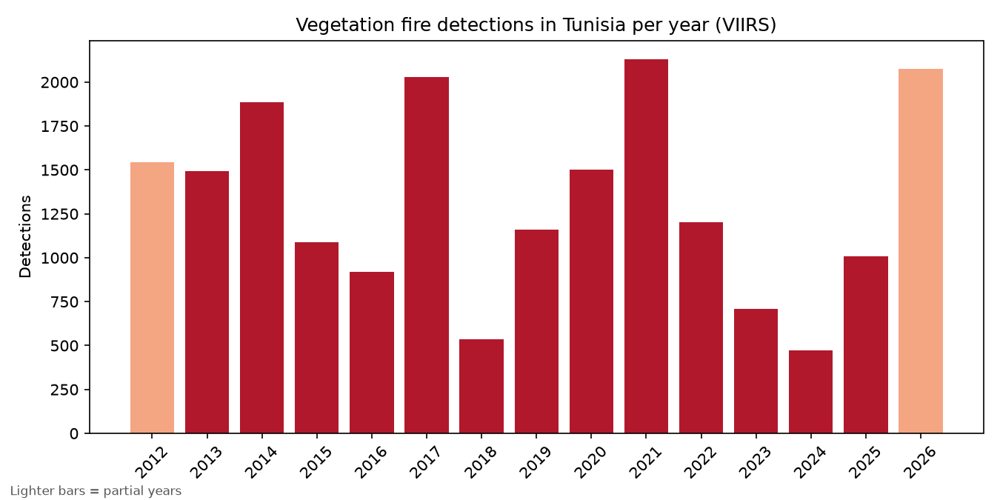
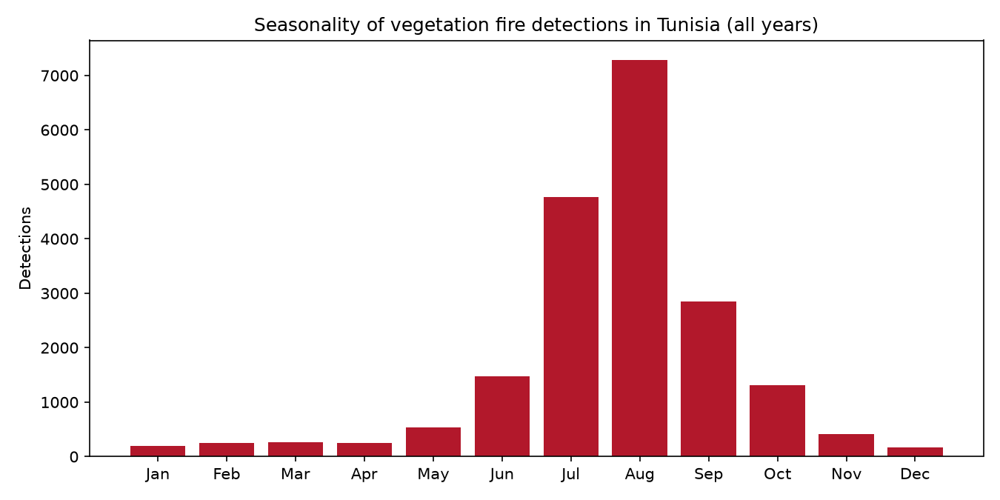

# Deep Learning for Wildfire Risk and Burned-Area Mapping in Tunisia

An independent research project analyzing NASA Earth observation data to characterize wildfire patterns in Tunisia, model fire risk, and automatically map burned areas with deep learning.

**Status:** In progress. Live fire map and historical VIIRS analysis are done; MODIS data, weather drivers and modeling come next. 🚧

## Goals

1. Characterize wildfire patterns in Tunisia over two decades (NASA FIRMS: VIIRS from 2012, MODIS from 2000)
2. Identify the climatic and vegetation drivers of fire risk (MERRA-2, NDVI)
3. Build a Random Forest baseline for fire risk
4. Train a PyTorch U-Net for burned-area segmentation, using MODIS MCD64A1 as reference labels, and compare it to the baseline (target Dice > 0.80)
5. Produce burned-area maps and a technical report

Focus area: the Kroumirie-Mogods region in the northwest, a historically fire-affected zone.

## Why

Tunisia has little public research on wildfire patterns, while NASA provides free, open data going back more than 20 years.

## Results so far (preliminary)

VIIRS S-NPP (375 m) active-fire detections for Tunisia, January 2012 to November 2026: 57,879 raw detections.





- **Almost half of the raw archive is not wildfire.** 46% of archive detections are flagged as static land sources (gas flares, industrial heat), so cleaning was essential before any analysis.
- **Fires are strongly seasonal**, concentrated in the summer months with a peak in July and August.
- **Spatial pattern:** after removing fixed sources, the densest clusters are in western Tunisia near the Algerian border, with elevated density across the northwest. Per-governorate counts and clustering are the next step. Download `outputs/tunisia_fire_density.html` and open it in a browser for the interactive heatmap.

## Data cleaning

Applied in `src/analyze_fires.py`:

1. Keep only archive detections classified as presumed vegetation fires (type 0).
2. Recent near-real-time detections have no type, so those that fall within about 500 m of a known static source are removed.
3. Drop low-confidence detections.
4. Remove persistent fixed sources the type flag missed: any ~500 m grid cell active in 6 or more different calendar months, or with 40 or more detections, plus its neighbouring cells. Removed detections are saved for inspection.

Result: 57,879 raw detections reduced to 19,753 cleaned vegetation-fire detections.

The thresholds in step 4 are heuristics, chosen after inspecting the most-repeated cells (`src/check_hotspots.py`), and will be revisited.

## Data sources

| Source | Used for |
|---|---|
| [NASA FIRMS](https://firms.modaps.eosdis.nasa.gov/) (VIIRS 2012+, MODIS 2000+) | Active fire detections |
| MODIS MCD64A1 | Monthly burned-area product, used as segmentation labels |
| MERRA-2 | Meteorological reanalysis (temperature, humidity, wind, rainfall) |
| [Copernicus Data Space](https://dataspace.copernicus.eu/) (Sentinel-2) | NDVI and before/after imagery |
| [geoBoundaries](https://www.geoboundaries.org/) | Tunisia governorate boundaries |

## Roadmap

**Phase 1: Live detection**
- [x] Project setup and Python environment
- [x] Near-real-time VIIRS fire data from the FIRMS API
- [x] Interactive map with governorate boundaries (`outputs/tunisia_fires_live.html`)
- [x] Single fetch-and-plot pipeline (`src/live_map.py`)

**Phase 2: Historical data and exploration**
- [x] Download historical VIIRS archive (2012 to 2026)
- [x] Clean the data and remove fixed industrial sources
- [x] Seasonality, yearly trends and density map
- [ ] Download and clean the MODIS archive (2001 to 2026), requested
- [ ] Per-governorate statistics
- [ ] Spatial clustering of persistent hotspots (DBSCAN/HDBSCAN)

**Phase 3: Drivers and baseline model**
- [ ] Download MERRA-2 weather variables and compute NDVI
- [ ] Add terrain and distance-to-road/settlement features
- [ ] Random Forest fire-risk baseline with time-aware and spatial validation

**Phase 4: Burned-area segmentation**
- [ ] Prepare MCD64A1 burned-area labels
- [ ] PyTorch U-Net for burned-area segmentation
- [ ] Compare against the Random Forest baseline (Dice)
- [ ] Burn severity (NBR) case study on one recent fire

**Phase 5: Write-up**
- [ ] Burned-area maps, technical report, demo

## Project structure

```
.
├── src/
│   ├── live_map.py          # Fetches recent VIIRS detections and builds the live map
│   ├── boundaries.py        # Downloads Tunisia governorate boundaries
│   ├── explore_history.py   # Merges the downloaded VIIRS CSVs and prints summary statistics
│   ├── analyze_fires.py     # Cleans the data, makes the charts and the density map
│   └── check_hotspots.py    # Lists the most-repeated detection cells (fixed-source check)
├── data/                    # Downloaded data (not tracked by git)
├── outputs/                 # Generated charts and maps
├── notebooks/               # Exploration notebooks
├── requirements.txt
└── README.md
```

## Getting started

Requires Python 3 and a free [NASA FIRMS MAP_KEY](https://firms.modaps.eosdis.nasa.gov/api/).

```powershell
git clone https://github.com/oumaimaDh/Deep-Learning-for-Wildfire-Risk-and-Burned-Area-Mapping-in-Tunisia.git
cd Deep-Learning-for-Wildfire-Risk-and-Burned-Area-Mapping-in-Tunisia

python -m venv venv
venv\Scripts\Activate
pip install -r requirements.txt
```

Create a `.env` file in the project root (it is gitignored):

```
FIRMS_MAP_KEY=your_key_here
```

Live map:

```powershell
python src/boundaries.py    # one-time: downloads governorate boundaries
python src/live_map.py      # saves outputs/tunisia_fires_live.html
```

Historical analysis: request Tunisia's VIIRS archive from the [FIRMS download page](https://firms.modaps.eosdis.nasa.gov/download/), unzip the CSV files into `data/viirs_raw/`, then run:

```powershell
python src/explore_history.py    # merge the CSVs, print summary statistics
python src/analyze_fires.py      # clean the data, save charts and the density map to outputs/
```

Notes:
- The near-real-time endpoint only returns the last 1 to 5 days, and the live map can be empty outside the summer fire season.
- Data files are gitignored, so each user downloads their own copy.

## Author

Oumaima Dhaouadi, 3rd year Computer Science Engineering student at ESPRIT (AI specialization). [GitHub](https://github.com/oumaimaDh)